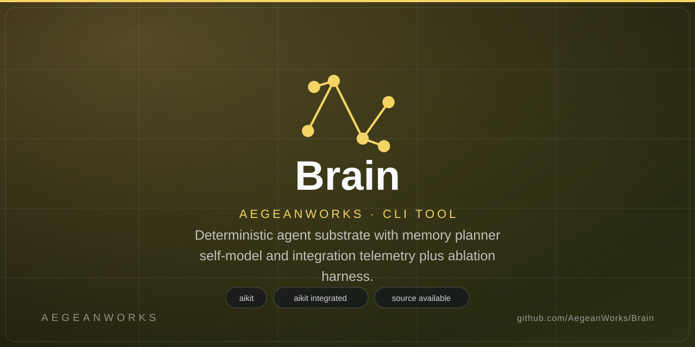

# Brain

<!-- aegean:media:start -->
<p align="center"></p>
<p align="center"><a href="LICENSE"></a> <a href="https://github.com/AegeanWorks/AIKit"></a></p>
<!-- aegean:media:end -->


Deterministic agent substrate with memory planner self-model and integration telemetry plus ablation harness.

## ⚡ 30-Second Cold-Start Quick Reference

- **Runtime Prerequisites**: Python 3.10+ stdlib only, no third-party packages.
- **Canonical Regression Shield Gate**:
  ```bash
  python -m unittest discover -s tests -t .
  ```
- **Cold-Start Recovery Battery**: `python -m evals.coldstart --capture`
- **Model-Trust Battery**: `python -m evals.trust`
- **Backend-Conformance Battery**: `python -m evals.backend_conformance`
- **Progress-Guard Battery**: `python -m evals.progress_guard`
- **Rule-Confidence Battery**: `python -m evals.rule_confidence`
- **Telemetry Lock Battery**: `python -m evals.telemetry_lock`
- **Cycle-Escape Battery**: `python -m evals.escape`
- **Manifest-Binding Battery**: `python -m evals.manifest_binding`
- **Dead-Pool Guard Battery**: `python -m evals.dead_pool`
- **Chain-Anchor Battery**: `python -m evals.chain_anchor`
- **Anchor-Journal Battery**: `python -m evals.anchor_journal`
- **Keyed Telemetry Battery**: `python -m evals.telemetry_mac`
- **Prompt-Budget Battery**: `python -m evals.prompt_budget`
- **Merkle-Anchor Battery**: `python -m evals.merkle_anchor`
- **Merkle-Journal Battery**: `python -m evals.merkle_journal`
- **Merkle-Compaction Battery**: `python -m evals.merkle_compaction`
- **Execution-Budget Battery**: `python -m evals.execution_budget`
- **Resume-Identity Battery**: `python -m evals.resume_identity`
- **Workspace-Binding Battery**: `python -m evals.workspace_binding`
- **Snapshot-Diff Battery**: `python -m evals.snapshot_diff`
- **Snapshot-Digest Battery**: `python -m evals.snapshot_digest`
- **Calibration Battery**: `python -m evals.calibration`
- **Calibration-Store Battery**: `python -m evals.calibration_store`
- **Calibration-Bridge Battery**: `python -m evals.calibration_bridge`
- **Calibration-Retention Battery**: `python -m evals.calibration_retention`
- **Calibration-Autoretention Battery**: `python -m evals.calibration_autoretention`
- **Claim-Verdict Battery**: `python -m evals.claims`
- **Claim-Store Battery**: `python -m evals.claims_store`
- **Claim-Evidence Battery**: `python -m evals.claim_evidence`
- **Claim-Ref Battery**: `python -m evals.claim_ref_verify`
- **Episode-Header Battery**: `python -m evals.episode_header`
- **Header-Reader Battery**: `python -m evals.header_reader`

### 🛠️ AIKit Commands (run from the AIKit folder)
| Role | Command |
|---|---|
| Status, task and gates | `python aikit.py status brain` |
| Phase 4: every gate | `python aikit.py check brain` |
| Repair memory and map, then check | `python aikit.py fix brain` |
| Resume an interrupted task | `python aikit.py resume brain` |
| Inspect lifecycle state machines | `python state_machines.py --list` |

## 📦 What's Inside

```text
brain/
├── .gitignore
├── COMMERCIAL.md
├── CYCLES.md                   <- cycle ledger
├── LICENSE
├── LICENSES/
├── REUSE.toml
├── README.md
├── assets/
├── inventory.py
├── demo.py
├── state_machines.py          <- explicit lifecycle registry (read-only)
├── agent.py                  <- rule-based perceive-plan-act-observe loop
├── budget.py                 <- opt-in step/LLM/token/time budgets
├── identity.py               <- episode digest + resume policy
├── workspace.py              <- deterministic source-tree hash for run evidence
├── snapshot.py               <- portable snapshots + deterministic diff
├── calibration.py            <- Brier/log-loss/reliability scoring
├── calibration_store.py      <- checksummed forecast journal
├── claims.py                 <- claim/kill-test/verdict ledger
├── claims_store.py           <- checksummed snapshots + backup
├── claims_verify.py          <- read-only verdict-ref check
├── episode_verify.py         <- independent episode-digest recomputation
├── episode_replay.py         <- replay logged actions through the world
├── run_verify.py             <- one call over every verifier
├── run_agent.py              <- run an episode by backend
├── models/                   <- swappable model backends
├── memory/                   <- SQLite FTS5 store + layout anchors
├── planner/                  <- explicit steps + recover
├── self_model/               <- budget/error/confidence counters + prediction
├── worlds/                   <- 8x8 fixed-step tasks T1-T3
├── telemetry/                <- JSONL append-only + ablation ops
├── evals/                    <- evidence and verification batteries
├── tests/                    <- unittest gate, tempdir only
└── .aikit/
```

## 🧊 Cold-Start Recovery Contract

A warm run stores one full initial state per `(task, seed)` in the additive
`layouts` table (first write wins). Only task-complete states are written: a
cold-first run cannot poison the row, and a later complete run replaces an
incomplete one. Rows store a geometry hash. A cold run whose
observations omit goal fields reads that layout once per episode; the
planner probe records `store_reads` plus the fields supplied by `state`,
`memory` or `persistent`, and the same fields reach the model-seam
observation. Cutting the source with `Planner.bind_recall_source(None)`
restores the store-blind behavior; cutting the completeness gate restores
cold-first poisoning. Property and trace share one ablation per scenario.

## 🔌 Pluggable Model Backends

`ModelBackend` is `generate()` plus `identity()`, which run headers pin.
Providers register by name; `build` raises `KeyError` listing the
choices. `check_backend` names `identity-from-class-name`,
`non-deterministic`, `non-string`, `no-proposal`, `illegal-token`,
`raises` (reported, not a violation).
`python -m evals.backend_conformance` runs four controls, exits 1 on
drift. `python -m run_agent --task T3_navigate --backend stub
--stub-script right,right,right` runs one episode; an unregistered
name exits 2 naming the choices.

## 🤝 Model-Seam Trust Contract

A legal backend proposal is trusted while fewer than 20 consecutive steps
pass without reward. Past that window a proposal differing from the rule
action is rejected (counted in `fallbacks`) and the backend stays
match-only and call-free. A no-op proposal (`wait`, `collect` before a
collectable, a blocked direction) is rejected whenever the rule has a
productive action; `noop_guard=False` removes that guard. A free-cell move
that strictly increases BFS distance to a fixed target is rejected as
`no-progress` when no items remain (T2/T3); `progress_guard=False`
restores accept-until-stall, and T1 tours or no-target states are
untouched. Rejections count in `progress_rejections` and the decision
carries `progress_guard` plus `progress: {proposed, rule}`. After
`progress_skip_after=3` consecutive rejections (reset by any non-progress
outcome) calls stop with `reason=skipped-progress` and
`progress_distrusted=True`; `progress_skip_after=None` keeps them for the
guard-only ablation. The policy key is
`backend_progress_skip: streak>=3->match-only`. `python -m
evals.progress_guard` shows T3:15 33 -> 13, T3:65 26 -> 6, T2:3 34 -> 8
steps; calls 21 -> 13/6/8 with the guard alone, 4/4/3 with the skip,
T1 stays 36/22. `skip_after_distrust=False` restores the redundant
calls; `trust_window=None` with both guards off is the raw control. Each
action record carries
`proposed/rule/steps_since_reward/distrusted/accepted/reason/skipped`;
`reason` is `stall` only on the triggering step, then `distrusted` or
`skipped`. Rule-only runs and good-backend replays keep their exact
actions and zero fallbacks.

## 🧭 Rule Confidence Readout

`Planner(rule_readout=True)` adds `probe.rule` to every step where the
rule has a goal: `goal`, the best post-move BFS `distance`, `ties` (free
moves at that distance), `confidence` (`1/ties`), `rule_distance`,
`optimal` (the rule action is at the minimum), and `alternatives` (each
best move with its recent-visit count). Unique moves read 1.0, two-way
ties 0.5; `collect`/`wait` at the goal read distance 0 and 1.0 with no
alternatives. `rule_readout=False` removes the field for the ablation;
it never selects an action. The policy key is
`rule_readout: bfs-move-ties`. `python -m evals.rule_confidence` shows
89/89 readouts, 113 alternatives over 28 tie steps, 1 tie with differing
visit counts, and the rule choosing the least-visited alternative in all
28 with identical on/off 89-step/11.0 traces, plus unique/tie/collect
fixtures.

On T1 movement steps the same readout adds `probe.tour`: the sorted
remaining items, the lexicographic shortest-tour first item, the
best/chosen tour lengths, every first item tied at the best length, and
`optimal`. `python -m evals.rule_confidence` finds 13 T1:71 tour steps
with 0 first-item ties and all 13 optimal; a synthetic two-item tie
(`[1,0]`/`[0,1]` from `[0,0]`) has two tied firsts and still chooses a
shortest tour. `rule_readout=False` removes the field; tour order is
unchanged.

## 🔗 Model-Manifest Binding

A backend that exposes `last_manifest` (model id, checkpoint label,
prompt, observation, sampling) has its manifest SHA-256 copied into
every `model_decision` as `model_manifest_sha256`. The trace binds each
action to its generation input, and a same-named checkpoint swap changes
the hash while the action trace stays identical. A raising call records
`null` instead of leaking a stale manifest. `probe_manifest=False`
removes the readout as the executable ablation. Weights never enter the
repo: the manifest carries labels and hashes only.
`python -m evals.manifest_binding` shows intact, probe-off, A/B.

## 🔮 Pre-Outcome Self-Prediction

`predict_outcome(state, action, task)` forms a probability *before*
`world.step`; `record_prediction` stores it, so `calibration` scores a
real forecast. Pooled over 20 seeds skill is +0.936/+0.937/+0.934
(T3/T1/T2); a constant predictor scores -0.067 and fails the bar.

## 🧭 Two-Blocker Dead-Pool Guard

For exactly two blockers, the planner compares BFS distance to the target
for the live and dead goal candidates before ordering the pool.
When the best live candidate is at least as close as the best dead one,
dead goal steps are dropped; the action record's `probe` gains
`dead_pool` with `position/excluded/live_distance/dead_distance`.
`dead_pool_filter=False` restores the old pool ordering for the
ablation. Three-blocker and single-blocker paths keep their existing
ordering, so their golden paths stay byte-identical. `python -m
evals.dead_pool` shows the `(7,5)` recovery (18 -> 16) and the ablation.

## 🔁 Repeated-Position Cycle Escape

For two or more blockers the planner counts how many times the current
cell appears in the full episode history. On the
second visit it takes one deterministic BFS step toward the target
(neighbor order `up/down/left/right`), instead of following the local
viability/pool order into the same loop. The action record's `probe`
gains `cycle_escape` with `position/visits/distance/action`. The gate is
memory-backed: `Planner(...).plan(state, None)` cannot see a repeat and
the old 200-step loop returns; `cycle_escape=False` is the executable
ablation. Single-blocker and open-field paths keep their existing
rules. `python -m evals.escape` shows both recovered three-blocker
layouts, the escape-off and memory-blind controls, and the unchanged
first prompt hash.

## 📏 Synergy Column Scope

`synergy` reads columns 0 and 1 only, so `syn` 0.0 cannot separate
absence from "signal outside them". `synergy_scope(...)` and
`synergy_null.synergy_verdict(...)` expose what the pair can decide
(ignored/constant/duplicate columns, sufficiency) and whether it beats
a permutation null (`p_upper`/`p_lower`, `distinguishable`);
`recompute` and each battery slot carry both; `dedupe_rows` collapses the
paired action/result record so `n` counts steps. Equal scope columns mean
no independent second signal: `duplicate-scope-column`; a constant reads
`constant-scope-column`. `evals.pair_scan` skips the target column, refuses
`target-column`/`target-leak-column`, and applies a family-wise max/min null
(`family_wise=False`/`guard_target=False` are ablations). Pairs carry
M/P/S/hub blocks; `module_interactions` counts cross-module pairs. No
Legacy pairs select none. `Agent(module_signals=True)` writes six
pre-action M/P/S signals plus versioned modes; `evals.module_state` pools them (ten T3 episodes:
12 raw / 8 unique pairs versus 0 legacy). `evals.replication` requires signed candidates to survive stability
and a held-out pool: the positive candidate fails; the two P-S anti-interactions replicate on T1 only (negative).

## 🧪 Lesion Detectability

`evals.lesion_audit.detectability(rows)` substitutes each block
(M/P/S/hub) with seeded noise and reports which modules each readout
separates from noise. On the fixed rig `synergy` detects `M`/`hub` and is
blind to `P`/`S`, so that invariance is the readout's blindness, not a
module finding; `phi` is blind to all four. Pinned by
`tests/test_lesion_detectability.py`.

## 🔁 Action Replay

`verify_chain` proves the bytes were not edited and
`verify_episode_header` proves the header config; neither reads the
actions, so a chain-valid log whose actions were all replaced still
verified. `episode_replay.verify_action_replay(log_path)` replays them
through `GridWorld(task, seed)` and compares each reward with the
world's own, the terminal `done` and the step count, naming
`reward-mismatch:<n>`, `done-mismatch` or `replay-short:<n><<m>`.
`verify_claim_refs(..., verify_replay=True)` composes it into claim
checks, and `check_verdict=True` rejects a verdict claim the replay
does not support. It proves the actions fit the named world, not that
a model produced them.

## 🧩 One Verdict Over Every Layer

`run_verify.verify_run(log_path, ...)` composes the shipped verifiers —
chain, episode digest with the policy/workspace/model pins, action replay
with the verdict claim and word, and result-record pairing — returning
`ok`, the union of findings and each layer's result under
`chain`/`episode`/`replay`/`results`. A raising layer is recorded as
`<layer>:<error>`, so one defect does not hide the others, and a failing
layer is named instead of collapsing to a bare false. It is as strong as
its weakest member, and a pin must be supplied. `python -m run_verify
--log PATH` runs it (0 clean, 1 finding, 2 misuse); `--json` prints all.

## 🧷 Terminal Telemetry Anchor

A run can write a separate `.anchor` sidecar with the final head digest
and record count via `Telemetry.write_anchor()`. Anchored verification
compares both: a shorter log reports
`truncated-tail:<count><<anchor_count>`, a different head/count reports
`anchor-mismatch`, and a missing witness reports `missing-anchor`.
Without the anchor, a truncated prefix remains internally valid; the
anchor is a separate witness and must be kept outside the tampered
log's control. `python -m evals.chain_anchor` shows intact, truncated and
anchor-off modes; the sidecar has hashes and counts only.

`Telemetry.write_anchor_journal()` appends the same head/count to a
`.anchors` JSONL journal where each anchor's `prev` links to the
previous anchor hash. `verify_anchor_journal()` checks every schema,
hash and prev link; `verify_chain(path, journal_path=...)` compares the
log with the latest anchor. A deleted middle anchor, a rewound seq or a
truncated log is named; deleting tail anchors still yields a shorter
valid journal unless the latest anchor is known externally. `python -m
evals.anchor_journal` shows the intact and truncated cases. The journal
is a separate, non-committed witness.

## 🔐 Keyed Telemetry (HMAC)

`Telemetry(path, hmac_key=bytes)` adds a per-record HMAC-SHA256 `mac`.
The digest excludes `mac`; the MAC covers the canonical record including
its digest, so a payload edit that recomputes the digest still fails the
MAC. `verify_chain(path, hmac_key=...)` reports `missing-mac:<index>` or
`bad-mac:<index>`. Without a key, records and bytes are unchanged; a
keyed verifier rejects an unkeyed log, and an unkeyed verifier cannot
check the MAC. Keys come from a secret store or environment, never from
the repository. `python -m evals.telemetry_mac` shows correct/wrong key, missing
MAC, recomputed-digest tamper and unkeyed parity.

## 🎚️ Prompt Token Budget

`build_prompt(observation, max_tokens=None)` uses the research-engine
`estimate_tokens`/`pack` helper: roughly four characters per token, the
anchor line always kept, and trailing lines dropped from the end. The
anchor carries the task, position, legal actions, target, items,
obstacles and cue; the visits line is last, so it is dropped first and
`OMITTED:n` names the omission. `max_tokens=None` keeps the original
single-line prompt byte-identical. `prompt_stats` returns
`tokens/omitted/lines`, and `LlamaCppBackend(prompt_budget=...)` applies
the budget and records `last_prompt_stats`; the manifest binds the
capped prompt. `python -m evals.prompt_budget` shows 63 / 52 tokens, 13 omitted,
actions unchanged.

## 🌿 Merkle Batch Anchors

`Telemetry.write_merkle_anchor(batch_size=64)` commits the last N record
digests to a separate `.merkle` sidecar with `start/end/count/root`.
`verify_merkle_anchor` checks the batch range and root;
`merkle_proof_for_record` returns a detached O(log n) inclusion proof
and `verify_merkle_proof` validates it. Leaf and node hashes are
domain-separated, an odd node is promoted rather than duplicated, and
an empty tree has a defined root. The anchor is a separate witness for
batch membership; run `verify_chain` separately for order/authorship.
`python -m evals.merkle_anchor` shows the intact 8-record batch
(12–20), a 3-sibling proof for record 15, and truncation/tamper
findings.

`Telemetry.append_merkle_anchor(batch_size=...)` appends each batch to a
`.merkle.journal` JSONL sidecar instead of overwriting `.merkle`. Each
record has the same `start/end/count/root` plus `prev` (the previous
record's `hash`) and `hash` (SHA-256 over the canonical payload); ranges
must not move backwards. `verify_merkle_journal` names `prev`,
`batch range rolls back`, `truncated-batch:<line>:<end>><count>`,
`root-mismatch:<line>` and `missing-journal` findings, and can validate
the links without a log. `merkle_proof_for_journal_record` proves a
record against the latest batch that contains it, so an earlier batch
stays provable after a newer anchor. `python -m
evals.merkle_journal` shows two chained batches (16–24, 24–32), record
20 still proving against batch 1, truncation/tamper/rollback findings,
and the old single-anchor overwrite that loses the earlier proof.

`compact_merkle_journal(log_path, journal_path=None, output_path=None,
replace=False)` merges every journal anchor into one record spanning
`min(start)..max(end)` with a freshly computed root, so every record in
that union keeps an inclusion proof. By default it writes
`<journal>.compact` and leaves the source untouched; `replace=True`
backs the source up as `.bak` and atomically replaces the live journal.
A `.compaction` sidecar records the source anchor count/head, union
range and compacted hash. Missing or truncated journals are refused, as
is `output_path == journal_path` without `replace=True`; a proof outside
the union is rejected. Compaction is an offline single-writer operation
because the append path does not lock against it. `python -m
evals.merkle_compaction` shows a 3-anchor 0–24 journal compacted to one
anchor, proofs for records 0/12/23, the replace backup (3 anchors), and
the 8–24 union boundary.

## 🧮 Execution Budgets

`budget_from_limits({...})` builds an `ExecutionBudget` with
`max_steps`, `max_llm_calls`, `max_tokens` and `max_seconds`.
`Agent.run(..., budget=...)` installs it through a context variable;
the loop spends one step before each action, the planner spends one
LLM call before each backend call and prompt tokens after it, and the
budget checks wall time on every spend. A tight limit raises
`BudgetExceeded(kind, limit, used)` naming the dimension, limit and
attempted usage; a generous budget leaves actions byte-identical, and
`budget=None` is a no-op. `python -m evals.execution_budget` shows a generous run and the
step/LLM/token/time caps.

## 🪪 Episode Identity & Resume

`input_digest(initial_state, config)` builds a canonical projection with
volatile keys (`ts`, `created_at`, `session_id`, …) removed and returns
the SHA-256 plus projection. `resume_decision` returns `resume`, `new`
or `ask`; `prepare_resume` pauses a refused candidate instead of
overwriting it. `run_task_logged` writes `episode_sha256` into the run
header: reruns with the same task/seed/config match, while a changed
seed, target or policy digest differs. `python -m
evals.resume_identity` shows same/volatile resume, changed seed/target
new, legacy ask, policy-any resume, and the 13/6-step header traces.

`run_task_logged` writes `seed` into the header alongside task, budget,
policy digest, episode digest and workspace. `verify_episode_header(path)`
rebuilds `GridWorld(task, seed)` and recomputes `input_digest`; digests
must be 64-hex (`invalid-policy`/`invalid-workspace`).
`expected_policy_sha256=` reports `policy-mismatch` even when the digest
is self-consistent (a forged policy with a matching digest);
`expected_workspace_sha256=` reports `workspace-mismatch` or
`missing-workspace`; `expected_model=` reports `model-mismatch` or
`missing-model`, so a swapped backend label cannot pass.
`verify_claim_refs(..., verify_episodes=True,
expected_policy_sha256=..., expected_workspace_sha256=..., expected_model=...)`
opts into the same checks and requires episode verification for any pin.
`python -m evals.episode_header` shows intact, wrong seed/episode,
missing seed/header, claims/tampered, the policy pins, invalid policy,
and every workspace path. The recomputation trusts the stored
task/seed/budget/policy: it proves internal consistency, not that the
run happened, and headers without a seed report `missing-seed`.
Verification reads only headers via `Telemetry.read_headers()`, so a long
action log costs O(1) retained memory; `python -m evals.header_reader` shows 100k records at 0.1 MB
peak vs 124.2 MB for `read_all`.

## 📁 Workspace Evidence Binding

`workspace_files(root)` maps each relative source file to SHA-256 and
`workspace_digest(root)` hashes the sorted path/digest lines. `.git`,
caches, logs, JSONL telemetry, databases and local reports are excluded,
so identical source trees rerun stable. `run_task_logged(...,
workspace_root=...)` writes `workspace_sha256` into the header; a
changed source file changes the digest, a cache file does not, and
`workspace_root=None` leaves the field null. `python -m
evals.workspace_binding` shows same/changed/ignored-cache/default cases
with the unchanged 13-step/1.0 T3:15 run.

## 🧾 Snapshot Diff

`capture_snapshot(cases)` runs each `(task, seed)` and returns records
with steps, reward, success, action hash, syn, `syn_sign`, phi, the synergy
`syn_scope`, `replay_ok` and `verdict_claimed`, so the diff gate names an
integrity regression that leaves behavior identical.
`export_snapshot`/`read_snapshot` write portable JSONL atomically.
`diff_records` matches by `(record_type, id)`, ignores volatile fields
(`created_at`, `ts`, `duration_ms`, …), and returns sorted
added/removed/changed lists plus a summary. `python -m
evals.snapshot_diff` shows empty and named diffs.

## 🔎 Snapshot Digests

`snapshot_digests(records)` returns the record count, an exact
`graph_sha256` over every field and a semantic `content_sha256` with
volatile fields removed recursively. `export_snapshot(...,
meta_path=...)` writes a `.meta` sidecar atomically;
`verify_snapshot` reports `record-count`, `graph-mismatch`,
`content-mismatch` or `missing-meta`. A re-capture changes the graph
digest but not content; a changed steps/action/syn field moves both.
`python -m evals.snapshot_digest` shows recapture, real change and
intact/tampered/missing meta.

## 📐 Calibration Scoring

`calibration.summary(forecasts, min_resolved=10)` scores forecast
records with Brier, log loss, base rate and five bins.
`outcome=None` is ignored.
`SelfModel.calibration()` scores them.
`record_prediction` forms the confidence *before* the action, so the
score is a real forecast (skill +0.935 over six pinned episodes); the
older `record` uses `1.0` rewarded or `0.5` otherwise, a function of
the outcome, and the readout appends a `confidence-is-outcome`
warning. The scorer never applies it.
`python -m evals.calibration` shows four fixtures.

`calibration_store.py` makes forecasts durable across runs.
`append_forecasts` validates each record, refuses duplicate ids, and
appends one checksummed JSONL line under an `O_CREAT|O_EXCL` lock
(30 s stale steal, bounded timeout, 10 MiB free). `load_forecasts`
raises on any defect; `verify_forecast_file` names corrupt lines,
checksum mismatches and duplicates without raising. An
optional `hmac_key=bytes` adds a per-record HMAC-SHA256; `load_forecasts`,
`load_all_forecasts`, `verify_forecast_file` and
`rotate_forecast_journal`/`append_forecasts(keep_recent=...)` accept the
same key, so a keyed journal can be rotated without dropping its MACs.
An unkeyed append or rotation over a keyed journal is refused, so a
mixed unauthenticated journal cannot be created by accident.
`python -m evals.calibration_store` shows the ablation, recovery and
keyed modes; keep the journal outside the source tree.

`run_task_logged(..., calibration_path=...)` is the opt-in bridge from a
real run to the journal. It requires a persistent `SelfModel` and
appends only that run's confidence/outcome pairs, ids prefixed by the
run header digest.
`calibration_hmac_key=bytes` appends keyed records through the bridge; it
requires `calibration_path` and is validated before the run. A default
run keeps the forecasts in memory and writes no file; the logged run
persists them, a second run appends only its new pairs, and the keyed
run writes records that load only with the key. Actions and rewards are
unchanged. A missing self-model or a corrupt journal raises; the verdict
is already written when the journal append fails. `python -m
evals.calibration_bridge` shows every mode.

`rotate_forecast_journal(path, keep_recent=100, archive_path=None)`
bounds the live journal: older records move to `.archive`, the newest N
stay live, the pre-rotation journal is copied to `.bak`, and a
`.rotation` sidecar records counts.
`load_all_forecasts` combines archive+live with disjoint ids and the
original scores; a short, missing or already-rotated journal is a
no-op. Id conflicts and corrupt files are refused; rotation holds the
store's writer lock. `python -m evals.calibration_retention` shows a
rotation with identical scores, the backup, a second rotation and the
conflict/missing/lock cases.

`run_task_logged(..., calibration_keep_recent=10)` applies the same
rotation after the run's append. `append_forecasts(..., keep_recent=N)`
performs the append and the rotation under one store lock;
`keep_recent=None` keeps every record live. The threshold is validated
before the run, so a missing path or invalid threshold fails without
creating the log or store. A rotation failure raises after the done
verdict with every forecast still live. `python -m
evals.calibration_autoretention` shows the retained, invalid, corrupt
and parity modes.

## 🧾 Claim & Verdict Register

`ClaimLedger.add(text, kill_test, confidence)` creates a proposed claim.
`record(id, status, evidence, at=...)` appends a `supports` or `refutes`
verdict and returns a new immutable claim; the previous
record is never mutated. Statuses are `proposed/supported/refuted/
inconclusive`, `summary()` counts claims/verdicts, and `to_dict`/
`from_dict` roundtrip as JSON. A claim's status derives from its
verdict history (`proposed` with none, otherwise the last verdict's
status); a claim or snapshot whose status contradicts that history is
rejected, even when its checksum was recomputed. Verdict evidence and timestamps are validated on load. `python -m evals.claims` judges six T3 claims (3/2/1).

`claims_store.py` makes the ledger durable. `save_ledger(ledger,
path)` writes one checksummed snapshot atomically, keeps the previous
as `.bak`, and holds an `O_CREAT|O_EXCL` lock (30 s stale steal).
`load_ledger` returns an empty ledger when no snapshot exists, loads the
primary, and on corruption quarantines it as `.corrupt`, falling back
to `.bak`; `verify_ledger_file` names `missing-primary`,
`invalid-primary`, schema and checksum defects.
`save_ledger(..., hmac_key=bytes)` adds an HMAC-SHA256 over the snapshot
(including its checksum); `load_ledger(..., hmac_key=...)` and
`verify_ledger_file(..., hmac_key=...)` require and verify it. A missing or
wrong MAC fails without quarantining the valid primary, so a key mistake
never destroys evidence. `python -m evals.claims_store` shows the ablation, recovery and keyed
modes; keep the snapshot outside the source tree. The
checksum detects accidental edits; the HMAC also detects a rewritten
checksum. An unkeyed save over a
keyed snapshot is refused, so authenticated evidence cannot be
downgraded.

`ClaimLedger.record(..., ref=...)` accepts an optional verdict ref, e.g.
the `episode_sha256` from a run header. It is stored on the frozen
`Verdict`, preserved through `to_dict`/`from_dict` and the store, and
old verdicts without one load as `None`. `python -m evals.claim_evidence` logs T3:15, records a supports
verdict with the header episode digest, saves/loads the claim and checks
that the ref matches; two runs keep distinct refs; a legacy payload
loads with `None`; an invalid ref leaves the history unchanged.

`claims_verify.py` checks refs against logs. `verify_claim_refs(ledger,
log_paths, hmac_key=None, verify_logs=True, journal_paths=None)` reads
every header `episode_sha256` and, by default, runs `verify_chain` on
each log first; `hmac_key` also verifies keyed records, and
`journal_paths` checks the log head/count against an anchor journal. A failed chain/MAC/journal check raises instead of
trusting the header. It reports `verified/unverified/unreferenced` and
names `unknown-episode` findings; `verify_claim_store` loads a snapshot
first and takes `store_hmac_key` to authenticate a keyed claim snapshot
(separate from the telemetry `hmac_key`). `verify_logs=False` is the
membership-only ablation and cannot take an `hmac_key` or journal.
`python -m evals.claim_ref_verify` shows verified, missing-log,
fabricated and unreferenced cases, the unkeyed/keyed store paths,
tampered and truncated logs, and the error modes. The chain check
detects edited/deleted/reordered records but not a fully rewritten
self-consistent log; HMAC requires key custody; the anchor journal is a
separate witness and can itself be rewritten.

## 🧾 Verdict Facts

A logged run is `done` only when it ended before the step budget. A run that
consumes the full budget is `truncated` even though the world's `done` flag is
set by the cap; the verdict reason always carries `steps` and `reward`, so a
capped run cannot read back as a success.

## 🔗 Multi-Writer Telemetry

Each JSONL append holds an advisory lock file from the head read through the
durable write, so concurrent writers form one hash chain instead of linking to
the same stale head. A lock older than 30 seconds is treated as a crashed
writer and broken atomically; a bounded timeout raises instead of writing
unprotected. Each acquisition writes a unique token, and release only unlinks
the lock if it still holds that token, so a slow writer whose lock was stolen
cannot delete its successor's lock (the same discipline covers the claim and
calibration stores). `python -m evals.telemetry_lock` shows the locked chain
and `--ablate` reproduces the broken pre-fix chain.

<!-- aegean:brand-assets:start -->
## 🎨 Brand Assets

> **AI-Generated Brand Artwork.** Banner and logo are illustrative AI-generated assets.
<!-- aegean:brand-assets:end -->

## 📜 License

Free for personal use under the Aegean License 1.1 (AL-1.1); see [LICENSE](LICENSE). Any commercial use needs the Aegean Commercial License 1.0 (ACL-1.0); see [COMMERCIAL.md](COMMERCIAL.md).
